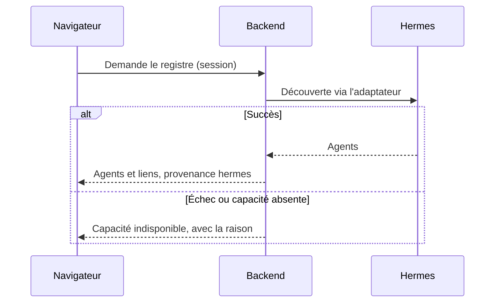
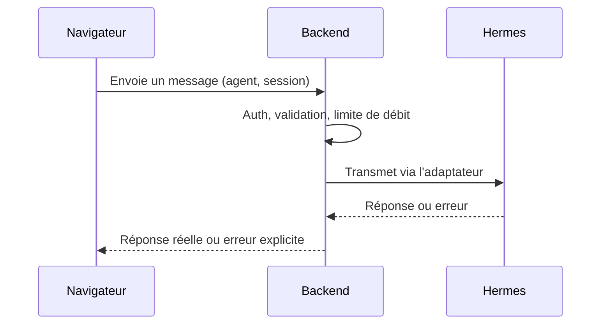

# Flux de données

Les interactions avec Hermes sont **volontairement décrites sans endpoint**. L'étape 07 les établira sur l'instance réelle.

## Lecture

## Action

Aucune action n'affiche un succès avant la réponse de Hermes.

## Événements

1. Une source (Hermes, application, simulation) produit un événement.
2. L'adaptateur le normalise en `ActivityEvent`, avec provenance et confiance.
3. Le bus ignore la clé d'idempotence déjà vue.
4. L'événement est stocké s'il doit l'être, puis diffusé.
5. Le client met à jour l'état observé, puis la scène choisit l'animation.

## Reconnexion

**Navigateur vers backend :** connexion WebSocket, puis snapshot complet, puis événements. Pendant la coupure, les états passent à `unknown`.

**Backend vers Hermes :** retry prudent avec délai croissant. Pendant la coupure, les états passent à `unavailable`. Un trou non récupérable est signalé dans le journal, jamais comblé.

## Déplacements

Les déplacements restent locaux, déclenchés par l'utilisateur ou la navigation de la scène. Ils ne dépendent pas d'événements Hermes sans rapport.
