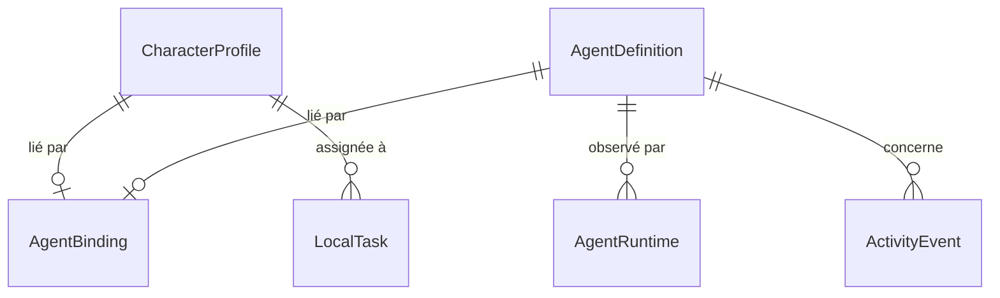

# Modèle de domaine

Contrats : `src/domain/`. Vérifiés par le compilateur, sans implémentation à ce stade.

| Objet | Propriétaire | Stocké où | Remarque |
|---|---|---|---|
| `CharacterProfile` | Application | PostgreSQL | Peut exister seul |
| `AgentBinding` | Application | PostgreSQL | Lien explicite, reste en place si l'agent disparaît |
| `AgentDefinition` | Hermes | Cache court, jamais source de vérité | Forme réelle à confirmer à l'étape 07 |
| `AgentRuntime` | Hermes | Mémoire | Peut valoir `unknown` |
| `ActivityEvent` | Hermes, application ou simulation | PostgreSQL avec rétention | Clé d'idempotence obligatoire |
| `LocalTask` | Application | PostgreSQL | Toujours de provenance `application` |

## Honnêteté dans les types

- **`Provenance`** (`hermes`, `application`, `simulation`) est un champ obligatoire : on ne peut pas créer de donnée sans source.
- **`Confidence`** (`confirmed`, `inferred`, `unknown`) distingue fait, déduction et ignorance. Une déduction porte sa règle.
- **`ObservedAgentState`** (`idle`, `working`, `thinking`, `waiting`, `error`, `unavailable`, `unknown`) ne contient pas de mise en scène : ni pause café, ni marche.
- **`VisualState`** est séparé et n'appartient qu'à l'affichage.
- **`Capability<T>`** vaut `available` avec une valeur, ou `unavailable` avec une raison. Il n'y a pas de valeur par défaut plausible.

## Lu ou stocké

| Donnée | Lecture | Stockage local |
|---|---|---|
| Agents, sessions, messages, événements bruts | Hermes | Non, sauf journal d'activité |
| Personnages, liens, emplacements, préférences | Application | Oui |
| Tâches locales | Application | Oui |
| Clés API Hermes | Variables d'environnement serveur | Jamais en base |
