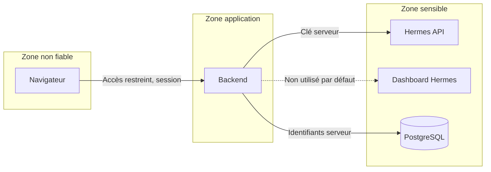

# Frontières de sécurité

## Règles

| Règle | Application |
|---|---|
| Le navigateur ne voit aucune clé | Variables serveur uniquement, jamais préfixées `VITE_` ; contrôle du bundle à l'étape 12 |
| Le navigateur n'atteint jamais Hermes | Aucun appel direct ; réseau interne |
| Pas d'accès au dashboard Hermes | Il lit et écrit le `.env` selon sa doc. Exception à justifier à l'étape 07 |
| Authentification partout | Toutes les routes et le WebSocket, hors santé |
| Exposition minimale | Opérateur unique au MVP, accès par VPN ou liste d'autorisation |
| Écritures explicites | Actions réelles listées dans `HERMES_API_CONTRACT.md` |
| Logs | Aucun secret ; contenu de conversation réduit au nécessaire |
| Moindre privilège | Clé Hermes et rôle PostgreSQL dédiés |

## Différences avec Claude-Office

Le source suppose une machine locale et un seul utilisateur : écoute sur loopback, routes sans jeton s'appuyant sur le contrôle d'origine. **Ces hypothèses tombent sur un VPS.** Le contrôle d'origine reste utile, mais il ne remplace pas l'authentification.

## Risque propre aux agents

Un message envoyé à un agent peut déclencher de vrais outils sur le serveur. Selon la documentation Hermes, les profils ne sont pas des sandboxes. Les étapes 07 à 11 se feront sur un profil de test à outils limités, à créer par l'opérateur.
