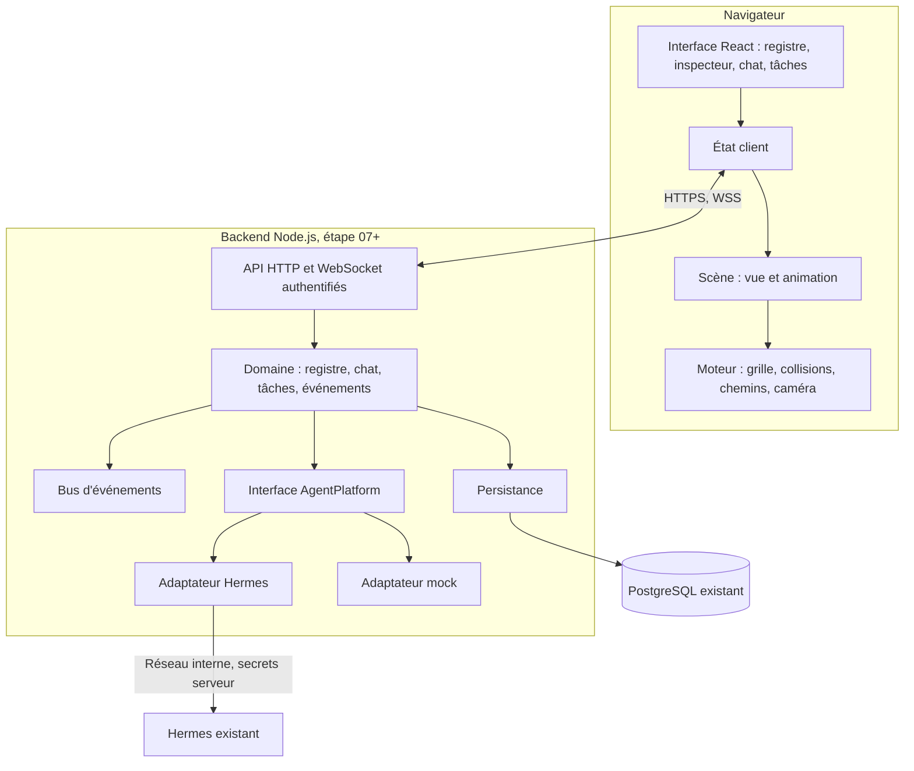
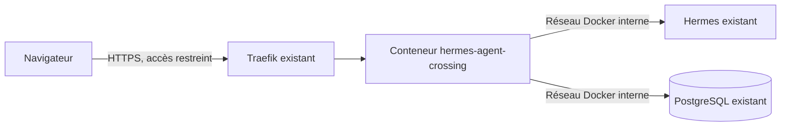

# Architecture cible

Statut : décidée sous le mandat du 2026-11-03, à relire par l'opérateur. Les modules marqués « étape 07+ » n'existent pas encore.

## Vue logique

**Règle de dépendance :** le moteur ne connaît ni React, ni le domaine, ni Hermes. Le domaine ne connaît pas Hermes, seulement l'interface `AgentPlatform`.

## Vue physique

Un seul nouveau conteneur : il sert l'interface et l'API. MinIO, pgvector et LiteLLM/vLLM ne sont pas utilisés au MVP, et le chat passe par Hermes, pas par un LLM direct.

## Modules

| Module | Emplacement | Responsabilité | Étape | Ne doit jamais |
|---|---|---|---|---|
| Moteur | `src/engine/` | Grille, carte, collisions, chemins, profondeur, caméra, boucle, rendu | 05 | Importer React, le domaine ou Hermes |
| Système de personnages | `src/characters/` | Catalogue, animation, sélection d'état | 06 | Déduire une activité |
| Scène | `src/scene/` | Composer carte, mobilier et personnages | 05, 06 | Lire l'API |
| Contrats du domaine | `src/domain/` | Types partagés | 04 | Contenir un endpoint |
| Registre d'agents | `server/registry/` | Découverte, liens | 08 | Écrire dans Hermes sans capacité vérifiée |
| Adaptateur Hermes | `server/adapters/hermes/` | Seul point de contact avec Hermes | 07 | Exposer une clé |
| Session et chat | `server/chat/` | Cycle de conversation | 09 | Appeler un LLM directement |
| Tâches | `server/tasks/` | Tâches locales | 10 | Se faire passer pour Hermes |
| Bus d'événements | `server/events/` | Normaliser, dédupliquer, diffuser | 10 | Inventer un événement |
| Persistance | `server/storage/` | Accès à PostgreSQL | 08 | Stocker un secret en clair |
| Authentification | `server/auth/` | Session de l'opérateur | 07, 12 | Laisser une route ouverte, hors santé |
| Administration | `src/ui/admin/` | Registre, liens, état des connexions | 08 | Afficher un statut non vérifié |

## Frontières

| Frontend | Backend |
|---|---|
| Affichage, interactions, déplacement local | Auth, secrets, appels à Hermes, persistance |
| Reçoit des données avec provenance | Attribue la provenance et le niveau de confiance |
| Décide de l'animation d'après l'état reçu | Ne connaît pas les animations |

Le navigateur ne parle **jamais** à Hermes.

## Coûts de migration

Estimations grossières en lots relatifs : aucune durée fiable n'est possible avant d'avoir vu Hermes.

| Lot | Effort relatif | Risque | Réutilisation du source |
|---|---|---|---|
| Moteur et scène | Élevé | Moyen | Idée du tri par `y` |
| Art | Moyen, réduit par le pipeline en code | Moyen | Aucune |
| Connecteur Hermes | Moyen à élevé | **Élevé**, instance non vue | Aucune |
| Registre et inspecteur | Moyen | Faible | `AgentCard`, `inspector.ts` |
| Chat | Moyen | Moyen | `SlackChat` |
| Tâches et événements | Moyen | Élevé (R1) | `TaskBoard`, schéma snapshot + événements |
| Authentification | Moyen | Moyen | Contrôle d'origine |
| Déploiement | Faible à moyen | Moyen | Aucune, pas de Dockerfile |

## Migration incrémentale

1. **05-06 :** application propre, sans backend, données simulées étiquetées.
2. **07 :** backend et adaptateur, séparés du frontend.
3. **08-10 :** import ciblé des composants utiles, avec leur mention MIT, après suppression du couplage.
4. **Jamais importés :** `theme.ts`, `officeReducer.ts` en bloc, hooks, Electron, skin.

## Stratégie de test

| Niveau | Outil | Portée |
|---|---|---|
| Unitaire | Vitest | Moteur, animation, règles de domaine |
| Assets | Vitest | Fichiers générés, conformes au manifeste |
| Contrat | Vitest, réponses Hermes réelles enregistrées | Adaptateur, dès l'étape 07 |
| Intégration | Vitest et Supertest | API, persistance |
| E2E | Playwright | Parcours P1 à P6 et rendu réel de la scène |

## Décisions

Voir [docs/adr](../adr).
