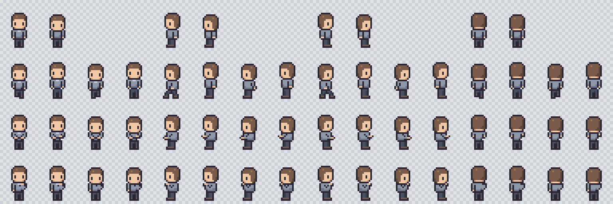

# Master Character

Personnage neutre, modèle de toute la famille.

Lecture de la planche : lignes `idle`, `walk`, `work`, `think` ; colonnes `down`, `left`, `right`, `up`, chacune avec ses frames.

- **Spritesheet :** `public/assets/characters/character-master.png`
- **Source :** `tools/art/character.mjs`
- **Provenance :** création originale pour ce projet, écrite en code. Aucun asset externe.

## Construction

Le personnage est assemblé à partir de pièces : tête (3 vues), buste (6 poses par vue), jambes (3 états par vue). Une frame n'est qu'une combinaison de ces pièces avec un petit décalage. **Il est donc impossible qu'une frame déforme les volumes**, ce qui répond à l'exigence de cohérence.

## Écarts connus

1. **Posture debout pour `work`** : le personnage tape debout. Une version assise pourrait être ajoutée si la scène le demande.
2. **Profil de `walk` dissymétrique** : une seule foulée écartée, l'autre position reprend la station debout. Cela reste lisible à l'échelle d'affichage.
3. **`think` discret** : main au menton, peu visible de dos. Une bulle complétera (étape 06).
4. **Pas encore jugé par un artiste** : les contrôles automatiques vérifient la technique, pas l'esthétique. **L'avis de l'opérateur reste à recueillir.**

## Validation

Le mandat du 2026-11-03 permet d'avancer sans validation intermédiaire. L'opérateur peut demander à changer ce personnage : une modification de `character.mjs` se répercute sur toute la famille.
