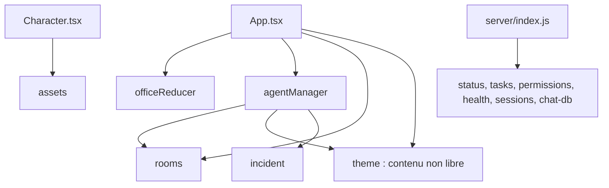

# Carte des dépendances

Commit `1a9ba71`, d'après `package.json`. Rien n'a été installé.

## Production

| Paquet | Usage | Décision |
|---|---|---|
| `react`, `react-dom` | Interface | Conserver |
| `express` | HTTP | Conserver (backend, étape 07) |
| `ws` | Temps réel | Conserver (backend, étape 07) |
| `better-sqlite3` | Chat | Retirer : PostgreSQL existe |
| `concurrently` | Scripts de développement | Retirer : c'est un outil de développement |

## Développement

| Paquet | Usage | Décision |
|---|---|---|
| `typescript`, `vite`, `@vitejs/plugin-react`, types | Build | Conserver |
| `vitest`, `supertest` | Tests | Conserver |
| `electron`, `electron-builder` | Application de bureau | Retirer |

## Dépendances non déclarées

- `scripts/generate-sprites.mjs` importe `@pixellab-code/pixellab` et `dotenv`.
- `scripts/generate-office-bg.mjs` importe `replicate` et `dotenv`.

Ces paquets ne sont pas dans `package.json`. Ces scripts ne fonctionnent donc pas après une simple installation.

## Prérequis système

| Élément | Utilisé par | Conséquence |
|---|---|---|
| CLI `claude` | Chat, CI, plugin | À retirer |
| `bash`, `python3` | Hooks et scripts de chat | À retirer avec les hooks |
| Node 22 | CI | À conserver |

## Dépendances entre modules

`agentManager.ts` importe `theme.ts`, donc les scènes et le contenu thématique sont liés.
