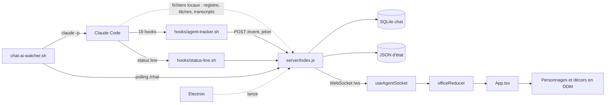
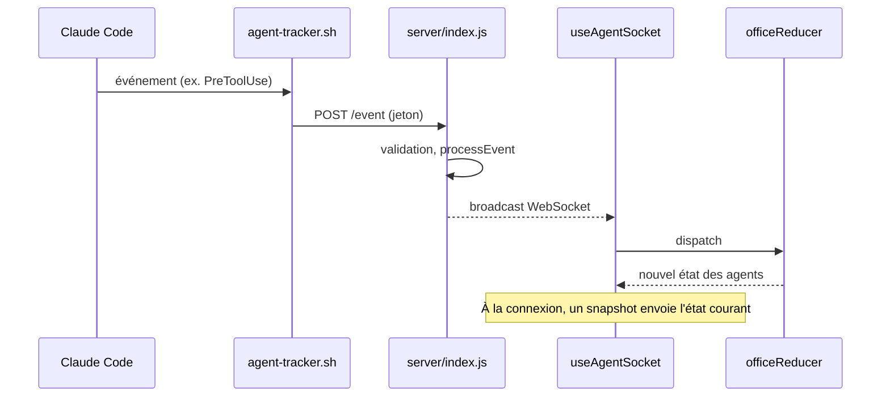

# Audit du code source de Claude-Office

Référence : [W17ant/Claude-Office](https://github.com/W17ant/Claude-Office), commit `1a9ba71` (2026-10-16), version `1.1.1`. Les chemins sont relatifs à ce dépôt.

## Méthode et limite importante

**Audit statique uniquement.** Le lancement de `npm ci`, des tests et du build a été refusé par le contrôle de sécurité de l'environnement, qui bloque l'exécution de code externe. Rien n'a donc été exécuté.

- Ce qui suit vient de la lecture du code, sauf mention contraire.
- Le nombre de tests et leur résultat restent des **affirmations du projet, non vérifiées** : le `README.md` annonce 972 tests ; un comptage par recherche de texte trouve 918 déclarations `it` ou `test`.
- « Maturité » est donc une appréciation de lecture, pas une mesure.

## Vue d'ensemble

| Élément | Constat | Preuve |
|---|---|---|
| Frontend | React 18, TypeScript, Vite | `package.json` |
| Backend | Node.js ESM, Express 4, `ws` | `package.json`, `server/index.js:22` |
| Stockage | SQLite (une table `messages`) et fichiers JSON d'état | `server/chat-db.js:51`, `tests/persistence.test.ts` |
| Bureau | Electron 33 en option | `electron/main.cjs` |
| Tests | Vitest ; 17 652 lignes dans `tests/` | `package.json` |
| CI | `tsc`, validation du plugin, tests, build, contrôle des assets | `.github/workflows/ci.yml` |
| Conteneurs | Aucun Dockerfile ni fichier compose | Absents de `git ls-files` |
| Ports | 3333 (UI), 3334 (serveur) | `server/config.js:26-27` |

## Architecture actuelle

## Flux temps réel

## Constats clés

1. **Le rendu n'est pas un moteur.** Les personnages sont des éléments DOM positionnés en pourcentage (`src/agentManager.ts:14`), la profondeur vient d'un `zIndex` basé sur `y` (`src/components/Character.tsx:198`). Le déplacement combine un polygone et des waypoints (`findWaypointPath`). Seule l'idée du tri par `y` se transpose.
2. **Le serveur est un monolithe.** `server/index.js` fait 3 753 lignes et regroupe routes, événements, sessions, chat et A2A. Les modules extraits (`status`, `tasks`, `permissions`, `health`) sont plus propres et s'injectent via `mount*(app, deps)`.
3. **Le frontend est concentré.** `src/App.tsx` (1 595 lignes) et `src/officeReducer.ts` (1 706 lignes) mélangent interface et domaine.
4. **Le modèle de sécurité suppose une seule machine.** Écoute forcée sur loopback (`server/config.js:108`, `server/index.js:66`), jeton de hook lu sur disque, contrôle d'hôte et d'origine. Aucun compte utilisateur.
5. **Les états visuels sont scénarisés.** Pauses café, marche vers le manager et événements aléatoires (`src/events.ts`) sont **contraires à notre principe d'honnêteté** s'ils sont repris tels quels.
6. **Les fichiers de Claude Code sont lus directement** : registre de sessions, tâches et transcripts (`server/sessions.js`, `server/tasks.js`, `server/transcript.js`).

## Bonnes pratiques à reprendre

- Injection de dépendances des modules (`createPermissionStore`, `createStatusStore`, `now` injectable).
- Contrôle d'origine sur WebSocket et HTTP, redaction des détails (`redactPermission`).
- Limitation de longueur des chaînes (`clampString`), validation stricte (`validateStatus`).
- `scripts/check-assets.mjs` : contrôle des assets référencés et d'un budget de taille.
- Mention « est. » pour une estimation : **le projet affiche déjà honnêtement une donnée estimée** (`docs/reference.md:224`).

## Décision issue de l'audit

**Ne pas forker tout le dépôt.** Construire une application propre dans `hermes-agent-crossing`, avec la même stack, et importer module par module ce qui se justifie, à partir de l'étape 07 : modèle d'inspecteur, cartes de permission, tableau et stores du serveur. Le code importé garde la mention MIT. Détail dans [FEATURES_REUSE_MATRIX.md](FEATURES_REUSE_MATRIX.md).

**Pourquoi :** les trois parties les plus volumineuses à conserver dans un fork (rendu, `officeReducer`, `server/index.js`) sont aussi les plus couplées, et les fichiers de sprites non libres devraient rester exclus de tout l'historique.

## Questions résolues pour l'étape 02

- Les assets ne sont pas importés dans ce dépôt pendant l'audit.
- Le catalogue visuel pointe vers les URL figées du dépôt source.
