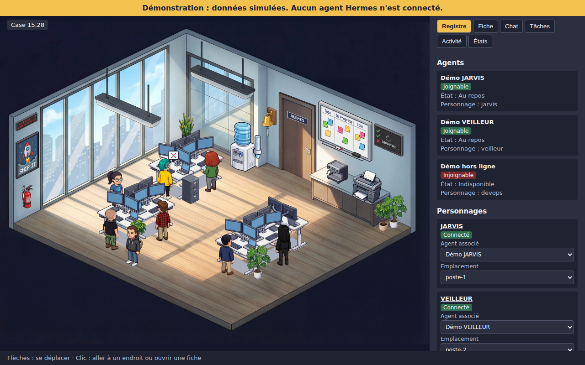
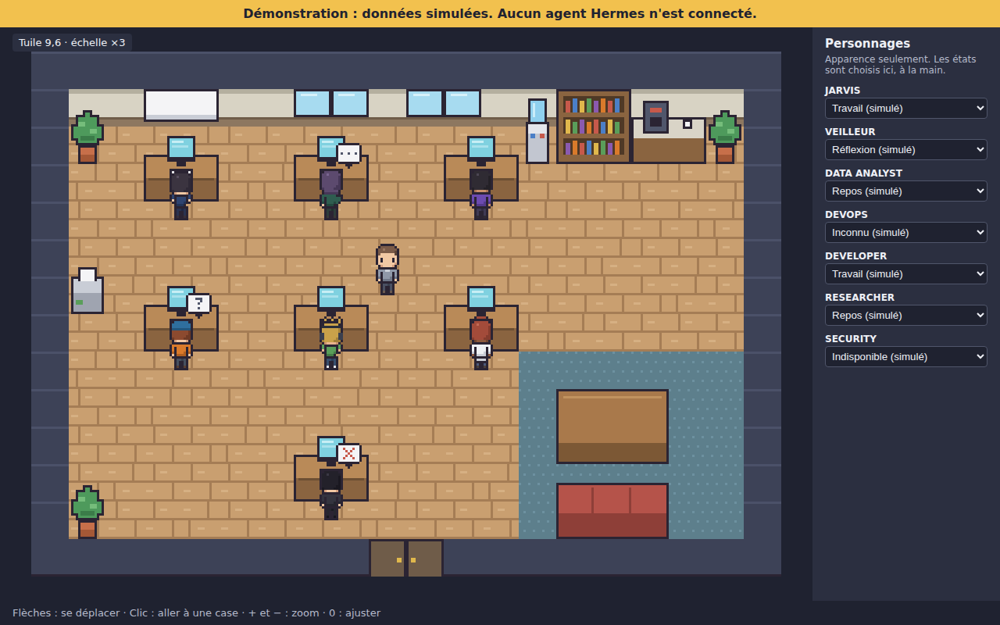
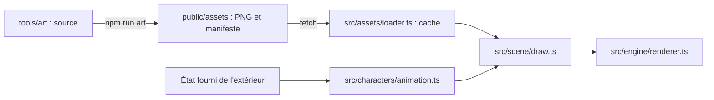

# Intégration des assets

## Bureau par défaut

La salle et les sprites de Claude-Office sont dans `public/assets/skin-source/`. `src/scene/sourceSkin.ts` décrit les positions, les poses et la zone de marche, et `src/scene/SourceOfficeCanvas.tsx` les dessine. Le moteur garde ses collisions et son A*, sur une grille invisible posée sur la zone de marche. Voir [ADR-008](../adr/ADR-008-sprites-claude-office.md).

La suite de ce document décrit l'ancien bureau, disponible avec `/?skin=pixel`.

## Ancien bureau

## Chaîne

## Catalogue technique

`public/assets/manifest.json` est généré et contient, avec des identifiants stables :

| Catégorie | Identifiants | Fichier |
|---|---|---|
| Personnages | `character.master`, `character.jarvis`… | `characters/character-<id>.png` |
| Tuiles | `tile.floor-wood`, `tile.wall-face`… | `environment/tiles.png` |
| Mobilier | `prop.desk`, `prop.plant`… | `environment/props.png` |
| Bulles | `bubble.unknown`, `bubble.thinking`, `bubble.unavailable` | `effects/bubbles.png` |

Le manifeste indique aussi le découpage, l'ancrage et la provenance.

## Animation pilotée par état

`CharacterAnimator` reçoit un `VisualState` et renvoie une frame. **Il ne déduit jamais d'état, et ne connaît pas Hermes.** L'étape 11 fournira le lien entre états réels et états visuels.

| État | Rendu |
|---|---|
| `idle`, `walk`, `work` | Animation correspondante |
| `think` | Animation et bulle `…` |
| `unknown` | Pose figée et bulle `?` |
| `unavailable` | Pose figée et bulle `✕` |
| Animation absente | Pose neutre figée, avec `fallback: true` |

## Honnêteté de la démonstration

- Bandeau permanent : données simulées, aucun agent connecté.
- Chaque état du panneau porte la mention « (simulé) » et se choisit à la main.
- Ces états n'imitent pas un comportement : rien ne change tout seul.
- Le tableau blanc est volontairement vide : il ne montre aucune fausse tâche.
- La démonstration n'appelle aucun service externe (testé).

## Chargement

- Une image n'est demandée qu'une fois, grâce au cache par URL, et peut être retentée après un échec.
- Le sol et les murs sont tracés une seule fois dans une image hors écran.
- Un fichier manquant déclenche un message d'erreur visible, jamais un écran trompeur.

## Ajouter un personnage

1. Ajouter sa palette et ses calques dans `tools/art/family.mjs`, sans redéfinir le corps.
2. Ajouter son nom dans `tools/art/assets.mjs`.
3. Lancer `npm run art`.
4. Mettre à jour la liste attendue dans `tests/assets/assets.test.ts`.
5. Lancer `npm test`, et regarder `docs/art/previews/character-family.png`.

## Ajouter un objet

1. Le dessiner dans `PROPS`, dans `tools/art/environment.mjs`, avec sa taille et son emprise.
2. Lancer `npm run art`.
3. Le placer dans `PROP_PLACEMENTS`, dans `src/scene/office.ts`.
4. Lancer `npm test` : les tests vérifient chevauchements, limites et accessibilité.

## Remplacer un PNG par le travail d'un artiste

Respecter [SPRITE_SPECIFICATION.md](../art/SPRITE_SPECIFICATION.md). Le test qui compare les PNG à leur source devra alors être adapté, et la provenance mise à jour.
