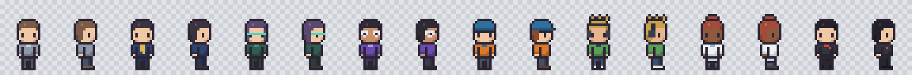

# Catalogue des personnages

## Bureau par défaut : sprites de Claude-Office

Voir [ADR-008](../adr/ADR-008-sprites-claude-office.md). Chaque personnage a 4 poses diagonales.

| Identifiant | Fichiers (`public/assets/skin-source/characters/`) |
|---|---|
| `character.master` (visiteur) | `employee-1-*` |
| `character.jarvis` | `dev-1-*` |
| `character.veilleur` | `explore-1-*` |
| `character.data-analyst` | `employee-2-*` |
| `character.devops` | `dev-2-*` |
| `character.developer` | `Frontend-dev-1-*` |
| `character.researcher` | `employee-3-*` |
| `character.security` | `security-audit-1-*` |

## Ancien bureau (`/?skin=pixel`) : famille écrite en code

De gauche à droite, de face et de profil : Master, JARVIS, VEILLEUR, DATA ANALYST, DEVOPS, DEVELOPER, RESEARCHER, SECURITY.

**Ce sont des apparences.** Aucun de ces personnages n'est relié à un agent Hermes à ce stade.

| Identifiant | Nom | Signe distinctif | Couleur principale |
|---|---|---|---|
| `character.master` | Master Character | Neutre | Gris-bleu |
| `character.jarvis` | JARVIS | Cravate dorée | Bleu nuit |
| `character.veilleur` | VEILLEUR | Cheveux longs, lunettes turquoise | Vert sombre |
| `character.data-analyst` | DATA ANALYST | Lunettes | Violet |
| `character.devops` | DEVOPS | Casquette | Orange |
| `character.developer` | DEVELOPER | Cheveux en pointes, casque audio | Vert clair |
| `character.researcher` | RESEARCHER | Chignon, blouse | Blanc |
| `character.security` | SECURITY | Badge rouge | Noir |

## Checklist qualité

**Automatique, vérifiée par `npm test` pour chacun des 8 personnages :**

| Contrôle | Résultat |
|---|---|
| Spritesheet 96×512, cellule 24×32 | Conforme |
| 4 animations, 4 directions, aucune frame vide | Conforme |
| Alpha à 0 ou 255 uniquement | Conforme |
| 16 couleurs au maximum | Conforme |
| Aucun pixel isolé | Conforme |
| Pieds alignés sur l'ancrage dans toutes les frames | Conforme |
| Aucun contact avec le bord de la cellule | Conforme |
| Fichier identique à sa source | Conforme |

**À l'œil, sur les planches et la scène :**

| Personnage | Contrôle visuel | Remarque |
|---|---|---|
| Master | Toutes les frames | — |
| VEILLEUR | Toutes les frames | Bandeau de lunettes plus marqué que de simples lunettes |
| JARVIS, DATA ANALYST, DEVOPS, RESEARCHER, SECURITY | Face, profil et scène | Autres frames non regardées une à une ; elles viennent des mêmes pièces |
| DEVELOPER | Face, profil et scène | Les pointes de cheveux évoquent un peu une couronne, à retoucher si elles gênent |

## Écarts connus

- Vus de dos, les personnages se ressemblent davantage : seuls la coiffure et les couleurs les distinguent.
- La cravate et le badge ne sont pas visibles de dos, par construction.
