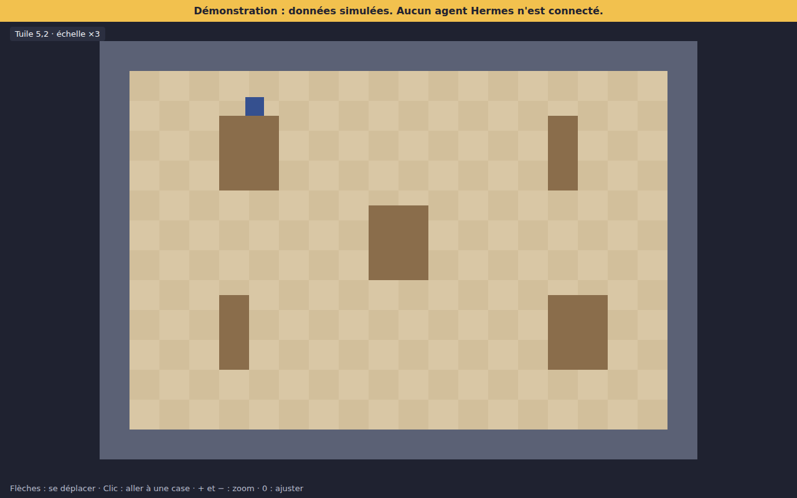

# Moteur orthogonal

Code : `src/engine/`. Il ne connaît ni React, ni le domaine, ni Hermes.

## Ce qu'il remplace

Il n'y a pas de moteur dans Claude-Office à adapter (voir [audit](../audit/SOURCE_CODE_AUDIT.md)) : des éléments DOM positionnés en pourcentage sur un fond isométrique. Le moteur est donc nouveau. Seule l'idée de trier selon `y` est reprise. Les fonctionnalités du source non reprises sont listées avec leur raison dans la [matrice de réutilisation](../audit/FEATURES_REUSE_MATRIX.md).

## Système de coordonnées

| Élément | Règle |
|---|---|
| Unité | Pixel du monde. Une tuile vaut 16×16 |
| Origine | Coin haut gauche de la carte ; `x` vers la droite, `y` vers le bas |
| Position d'un acteur | **Ses pieds**, pas le coin de son sprite |
| Monde vers tuile | `floor(valeur / 16)`, y compris en négatif |

## Modules

| Fichier | Rôle |
|---|---|
| `grid.ts` | Conversions monde et tuile |
| `tilemap.ts` | Carte depuis du texte, cases bloquées ; le hors-carte est bloqué |
| `collision.ts` | Boîte aux pieds (10×6 px), déplacement axe par axe, glissement le long des murs |
| `pathfinding.ts` | A* en 4 directions, déterministe |
| `actor.ts` | Déplacement direct ou par trajet, orientation |
| `camera.ts` | Zoom entier, centrage, suivi, conversion écran vers monde |
| `renderer.ts` | Tri de profondeur et dessin d'une image |
| `loop.ts` | Boucle à pas fixe (60 Hz), abandon d'un long retard |

## Profondeur

Chaque élément fournit une `depth`, sa position verticale de base. Les éléments sont tracés de la plus petite à la plus grande, avec un tri stable. Un personnage derrière un meuble est donc masqué par son sommet, et passe devant quand il est dessous.

## Rendu pixel-perfect

- Zoom **entier uniquement** (×1 à ×8).
- `imageSmoothingEnabled = false` à chaque image, et `image-rendering: pixelated` en CSS.
- Décalages de vue entiers ; positions dessinées arrondies au pixel du monde.

## Caméra et performances

Le monde est centré s'il tient dans la vue. Sinon, la caméra suit le personnage sans montrer le vide, et le canvas suit la taille de la fenêtre.

**Performances non mesurées** : la scène est petite. L'A* trie sa liste à chaque tour, ce qui suffit pour une salle, mais pas pour de grandes cartes.

## Démonstration

```bash
npm run dev
```

Flèches : déplacement. Clic : aller à une case. `+`, `-`, `0` : zoom. Un bandeau signale la simulation.



Cette capture montre l'étape 05, avec ses graphismes provisoires. La scène actuelle est décrite dans [ASSET_INTEGRATION.md](ASSET_INTEGRATION.md).

## Tests

| Commande | Portée |
|---|---|
| `npm test` | Coordonnées, collisions, chemins, acteur, caméra, tri, rendu, boucle |
| `npm run test:e2e` | Dans Chromium : clavier, murs, clic, zoom, redimensionnement, bandeau |

## Procédure de validation visuelle

1. Lancer `npm run dev` et vérifier des bords nets à chaque zoom.
2. Passer derrière un obstacle : le bas du personnage doit être masqué.
3. Passer devant : le personnage doit rester entier.
4. Pousser contre un mur en diagonale : il doit glisser sans trembler.

## Limites

- Pas d'évitement entre personnages.
- Une case entière est bloquée ou libre.
- Le DPR est pris en compte, mais testé seulement à 1.
- Testé sur Chromium uniquement.
