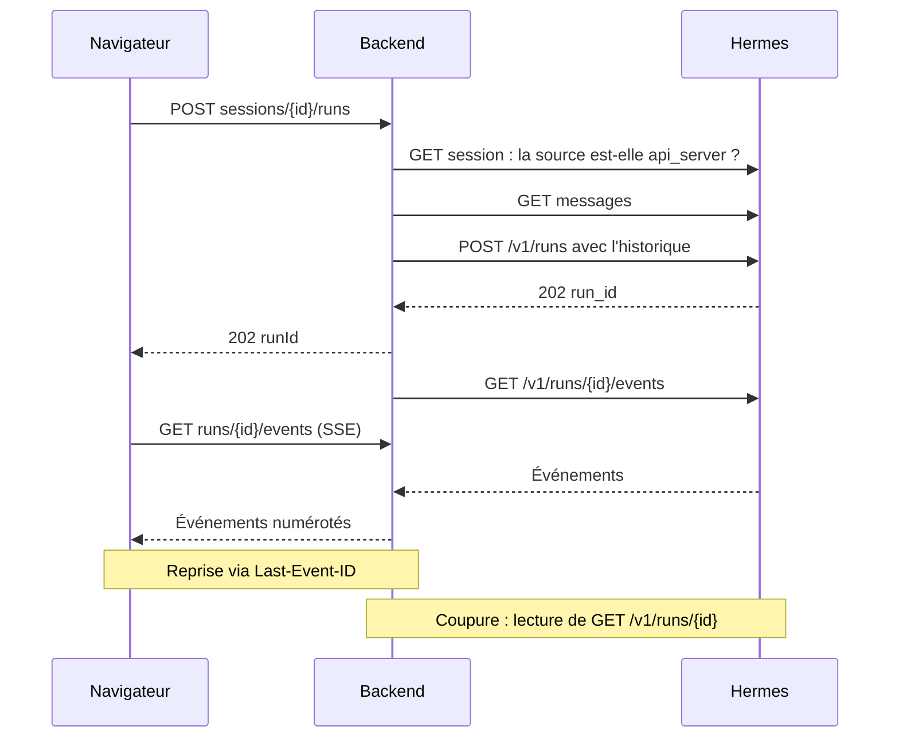

# Flux du chat avec Hermes

## Pourquoi un relais

Hermes ne permet **qu'une lecture** du flux d'un run. Le backend la consomme, garde les événements en mémoire, les numérote, et peut les rejouer pour un navigateur qui se reconnecte.

## Limites de l'API en v0.17

| Limite | Conséquence |
|---|---|
| Un run ne recharge pas l'historique | Le backend l'envoie : `role` et `content`, sans les appels d'outils passés |
| État du run en mémoire de Hermes | Après redémarrage de Hermes : « Résultat inconnu » |
| Événements en mémoire du backend | Après redémarrage du backend : le suivi est perdu, et l'interface l'indique |
| 10 runs simultanés au plus | Au-delà, l'erreur de Hermes est affichée |
| Flux orphelins nettoyés après 300 s | Une autorisation sans réponse pourrait expirer. **À observer** |
| Événements des sous-agents non transmis | Leur activité n'apparaît pas |
| Arrêt par interruption | Hermes ne peut pas forcer la fin d'un outil lancé. L'arrêt peut prendre du temps |

## À vérifier sur l'instance

1. **Enregistrement :** les messages d'un run apparaissent-ils dans `/messages`, sans doublon ? C'est indiqué par le source, mais pas observé.
2. **Autorisation :** l'événement `approval.request` contient-il bien `command` et `description` ?
3. **Sessions :** un run lié à une session créée par `POST /api/sessions` reste-t-il bien dans cette session ?
