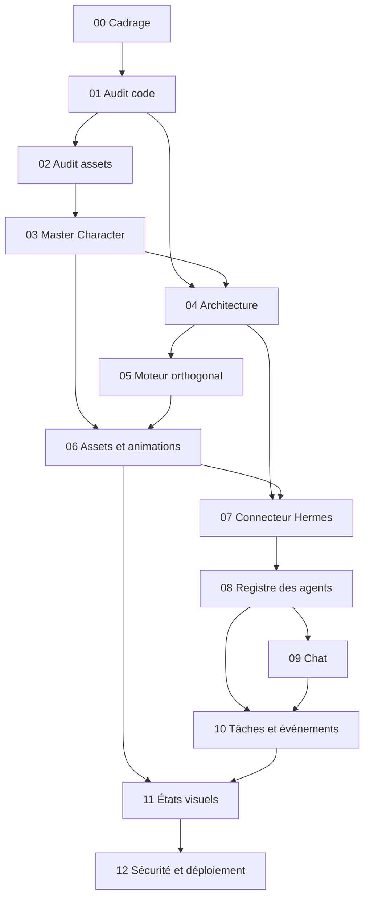

# Jalons, dépendances et livrables par phase

Statut : **proposition, en attente de validation** · Étape 00 · 2026-11-03

Aucune durée n'est indiquée : l'effort réel de l'étape 05 et de la production graphique ne peut pas être estimé avant les audits. Un chiffrage est demandé à l'étape 04.

## Jalons

| Jalon | Phases | Résultat vérifiable |
|---|---|---|
| **J1 — Base comprise** | 00, 01, 02 | Décision documentée sur ce qui est réutilisé, code et assets |
| **J2 — Conception validée** | 03, 04 | Master Character approuvé et architecture approuvée |
| **J3 — Monde simulé** | 05, 06 | Bureau jouable, données simulées clairement identifiées |
| **J4 — Hermes branché** | 07, 08 | Agents réels découverts et associés à des personnages |
| **J5 — Interaction réelle** | 09, 10, 11 | Conversation réelle, activité et animations fondées sur des données vérifiées |
| **J6 — Mise en service** | 12 | Tests passés et recommandation Go/No-Go |

## Dépendances

Le README impose un ordre strictement séquentiel, qui reste la règle. Le schéma montre les dépendances techniques réelles.

**Suggestion à valider :** commencer l'inspection de Hermes (partie audit de l'étape 07) dès que possible, en lecture seule, avant l'étape 04. Ses résultats (R1, H3, H4) peuvent modifier l'architecture et le périmètre. Attendre l'étape 07 ferait découvrir ces limites après la construction du moteur et des assets.

## Livrables par phase

| Phase | Documents | Autres livrables | Porte de sortie |
|---|---|---|---|
| **00 Cadrage** | `docs/product/PROJECT_BRIEF.md`, `MVP_SCOPE.md`, `USER_JOURNEYS.md` ; `docs/project/ASSUMPTIONS_AND_RISKS.md`, `ACCEPTANCE_CRITERIA.md`, `MILESTONES.md` | Aucun | Périmètre et questions validés |
| **01 Audit code** | `docs/audit/SOURCE_CODE_AUDIT.md`, `FEATURES_REUSE_MATRIX.md`, `DEPENDENCY_MAP.md`, `API_AND_EVENTS_MAP.md`, `CLAUDE_CODE_COUPLING.md` | Schémas Mermaid | Composants à conserver validés |
| **02 Audit assets** | `docs/art/ASSET_INVENTORY.md`, `ASSET_LICENSE_AUDIT.md`, `ORTHOGONAL_COMPATIBILITY.md`, `ASSET_PIPELINE.md` | Catalogue visuel, liste d'assets approuvés | Matrice de décision validée |
| **03 Personnages** | `docs/art/ART_DIRECTION.md`, `SPRITE_SPECIFICATION.md`, `MASTER_CHARACTER.md`, `CHARACTER_FAMILY.md`, `ANIMATION_SPECIFICATION.md` | Prototype et spritesheet du Master Character, plan de production | Master Character approuvé |
| **04 Architecture** | `docs/architecture/TARGET_ARCHITECTURE.md`, `DOMAIN_MODEL.md`, `DATA_FLOWS.md`, `SECURITY_BOUNDARIES.md`, `docs/adr/ADR-*.md` | Contrats TypeScript si validés, coûts de migration | Architecture et coûts validés |
| **05 Moteur** | `docs/graphics/ORTHOGONAL_ENGINE.md` | Scène de démonstration, tests | Déplacement, collisions, profondeur et rendu démontrés |
| **06 Assets** | `docs/graphics/ASSET_INTEGRATION.md`, `CHARACTER_CATALOG.md` | Catalogue technique, personnages, scène meublée, tests | Démonstration et checklist par personnage |
| **07 Connecteur** | `docs/integrations/HERMES_CAPABILITY_AUDIT.md`, `HERMES_API_CONTRACT.md`, `HERMES_CONNECTOR.md` | Adaptateur, tests de contrat, procédure de configuration | Matrice des capacités vérifiées |
| **08 Registre** | `docs/product/AGENT_REGISTRY.md`, `docs/architecture/AGENT_DOMAIN_MODEL.md` | Registre, inspecteur, tests | Découverte et association démontrées |
| **09 Chat** | `docs/product/CHAT_BEHAVIOR.md`, `docs/integrations/HERMES_CHAT_FLOW.md` | Chat dans l'inspecteur, tests | Conversation réelle démontrée |
| **10 Tâches** | `docs/product/TASKS_AND_EVENTS.md`, `docs/architecture/EVENT_MODEL.md` | Tableau, journal, tests | Flux réels et locaux présentés séparément |
| **11 États visuels** | `docs/graphics/AGENT_VISUAL_STATE_MACHINE.md` | Table de correspondance, synchronisation, panneau debug, tests | Transitions démontrées |
| **12 Mise en service** | `docs/deployment/DEPLOYMENT.md`, `ENVIRONMENT_VARIABLES.md` ; `docs/security/SECURITY_REVIEW.md` ; `docs/operations/RUNBOOK.md` | Configuration Docker/Dokploy, rapport de tests, checklist | Recommandation Go/No-Go |

## Points d'accord de l'opérateur

Ces actions exigent un accord explicite, même si la phase est déjà validée :

- toute modification de la configuration de production Hermes ;
- toute création ou suppression d'agent Hermes ;
- toute modification du firewall ou d'un service de production ;
- toute migration destructive ;
- tout déploiement en production.
