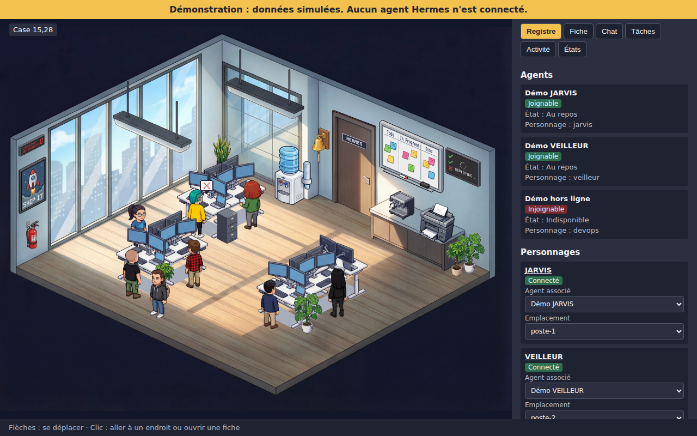

# Rapport — Adoption du bureau et des sprites de Claude-Office

## En résumé

Le bureau par défaut utilise maintenant la salle, le mobilier et des personnages de Claude-Office, à ta demande. Le reste de l'application ne change pas. L'ancien bureau reste disponible avec `/?skin=pixel`.

Décision complète : [ADR-008](../adr/ADR-008-sprites-claude-office.md).

## Erreur de ma part

L'audit de l'étape 02 a écarté ces images trop vite, et je t'ai dit à tort que sans grille, on ne pouvait pas gérer les déplacements. La salle a déjà une zone de marche et des emplacements, et chaque personnage a 4 poses diagonales.

## Ce qui a été fait

- Salle de jour, mobilier et 8 personnages copiés, avec la licence et la notice.
- Plaque « CLAUDE » de la porte remplacée par « HERMES ».
- Déplacements, clic sur un personnage et bulles d'état branchés sur le moteur existant.
- Audit, décisions, critères d'acceptation et README corrigés.

## Preuves

| Vérification | Résultat |
|---|---|
| `npx tsc --noEmit` | Aucune erreur |
| `npm test` | 262 tests réussis |
| `npm run test:e2e` | 37 tests et 1 capture réussis dans Chromium |
| `npm run build` et `npm run check:build` | Réussis, 60 fichiers contrôlés |
| `npm audit --omit=dev` | 0 vulnérabilité |
| Contrôle visuel | Capture et plaque de la porte regardées |

Comme avant, ces tests tournent face à un mock et à un faux Hermes.

## Critères d'acceptation modifiés

| Critère | Changement |
|---|---|
| CA-10 | Vue orthogonale retirée du critère |
| CA-11 | Ne vaut plus que pour `/?skin=pixel` |
| CA-12 | Retiré pour le bureau par défaut |
| CA-22 | Licence MIT annoncée, provenance à clarifier |
| CA-24 | Étendu aux images réutilisées |

## Non vérifié / limites

- **Provenance :** à clarifier avec l'auteur, W17ANT, avant une diffusion publique.
- **Poids :** environ 15 Mo d'images. Performances non mesurées.
- **Animation :** pas d'images de pas, le personnage glisse en oscillant.
- **Zoom :** plus de zoom au clavier sur le bureau par défaut.
- **Testé sur Chromium uniquement.**
- **Décor :** l'affiche « SHIP IT » et le tableau de tâches peint restent dans l'image. Ce tableau ne reflète aucune tâche réelle.
- **Le verdict ne change pas : No-Go pour la production** tant que rien n'a tourné sur ton VPS.
