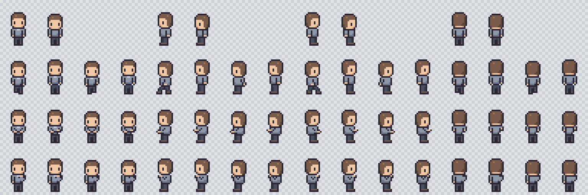

# Rapport — Étape 03 : Master Character

## En résumé

J'ai créé le personnage modèle, avec 4 directions et 4 animations : repos, marche, travail, réflexion.

## Ce qui a été fait

- Direction artistique : tuiles de 16 px, personnages de 24×32 px, vue de dessus.
- Spritesheet exploitable par le moteur, dont le découpage est documenté.
- Fiches visuelles des 7 personnages, sans rien présumer de leur configuration Hermes.
- Contrôle qualité automatique.

## Le choix à connaître

**L'art est écrit en code, pas généré par une IA.** C'est un changement par rapport à ma recommandation de l'étape 00. Je n'ai pas de générateur d'images ici, et cette méthode a de vrais avantages : toutes les frames partagent les mêmes pièces, donc aucune déformation, et l'origine de l'art est claire. La famille se décline sans dessin supplémentaire.

## Preuves

`node tools/art/build-master.mjs` passe tous les contrôles : taille, transparence, couleurs, pixels isolés, pieds alignés. J'ai aussi regardé la planche agrandie, et corrigé un pixel de main qui dépassait.

## Non vérifié / limites

- **L'avis esthétique reste le tien** : les contrôles vérifient la technique, pas la beauté.
- Le personnage travaille debout, et la réflexion est discrète de dos.

## Livrables

- [ART_DIRECTION.md](../art/ART_DIRECTION.md)
- [SPRITE_SPECIFICATION.md](../art/SPRITE_SPECIFICATION.md)
- [MASTER_CHARACTER.md](../art/MASTER_CHARACTER.md)
- [CHARACTER_FAMILY.md](../art/CHARACTER_FAMILY.md)
- [ANIMATION_SPECIFICATION.md](../art/ANIMATION_SPECIFICATION.md)
- Spritesheet : `public/assets/characters/character-master.png`
