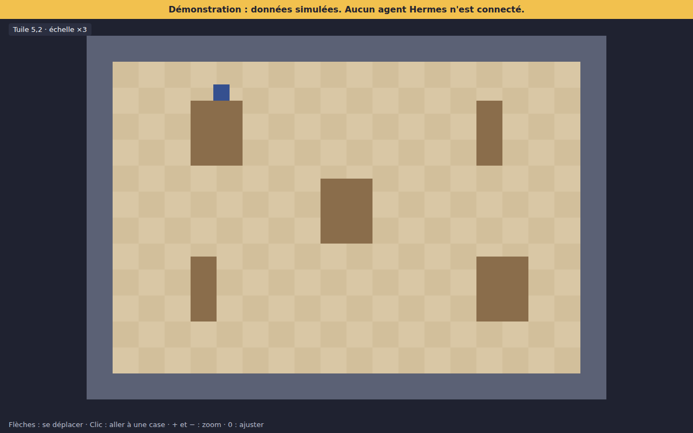

# Rapport — Étape 05 : Moteur orthogonal

## En résumé

Le bureau a maintenant un vrai moteur en vue de dessus. On peut y déplacer un personnage temporaire, au clavier ou au clic. Il s'arrête aux murs, contourne les obstacles et passe derrière eux.

## Ce qui a été fait

- Grille de 16 px, collisions, recherche de chemin, tri de profondeur.
- Caméra avec zoom entier, pour garder des pixels nets.
- Scène de démonstration, avec un bandeau qui annonce la simulation.
- Aucune dépendance à Hermes.

## Preuves

| Vérification | Résultat |
|---|---|
| `npm test` | 31 tests réussis |
| `npm run test:e2e` | 6 tests réussis dans Chromium, plus 1 capture |
| `npm run build` | Réussi |
| Capture regardée à l'œil | Le personnage est bien coupé par l'obstacle devant lui |

## Non vérifié / limites

- Performances non mesurées, mais la scène est petite.
- Testé sur Chromium uniquement, avec un écran standard.
- Les personnages ne s'évitent pas entre eux.
- Graphismes provisoires : ils sont remplacés à l'étape 06.

## Écart par rapport au prompt

Le prompt demandait d'« adapter » le moteur de Claude-Office. Il n'en a pas, donc celui-ci est nouveau.

## Livrables

- [ORTHOGONAL_ENGINE.md](../graphics/ORTHOGONAL_ENGINE.md)
- Moteur : `src/engine/`
- Scène : `npm run dev`
