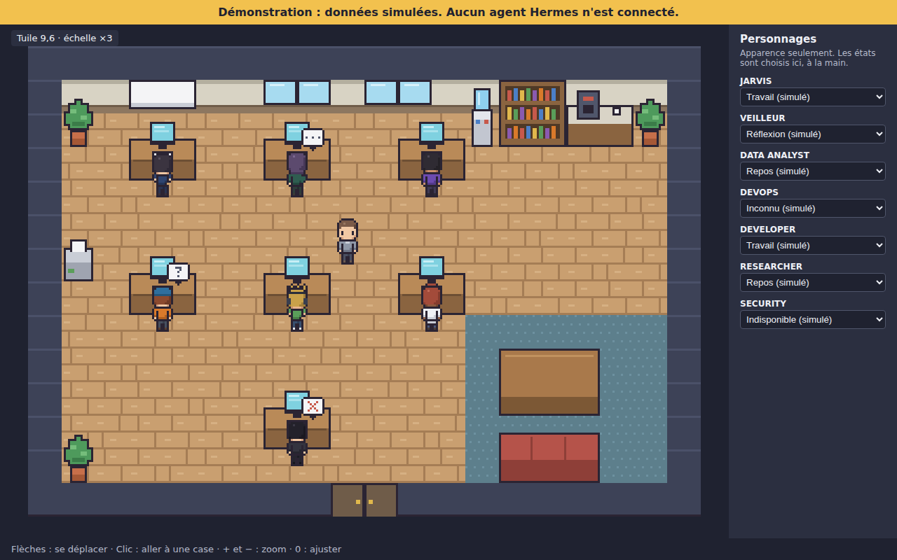

# Rapport — Étape 06 : Personnages, décors et animations

## En résumé

Le bureau est maintenant meublé et habité : 7 personnages à leur poste, plus un visiteur que tu déplaces. Tout est simulé, et l'écran l'annonce clairement. Aucun agent Hermes n'est connecté.



## Pour le voir

```bash
npm run dev
```

Puis ouvre l'adresse affichée. Flèches ou clic pour te déplacer, `+` et `-` pour zoomer. Le panneau de droite change l'état de chaque personnage.

## Ce qui a été fait

- Les 7 personnages déclinés du Master Character, plus tuiles, mobilier et bulles.
- Catalogue avec des identifiants stables et la provenance de chaque asset.
- Animations pilotées par un état choisi de l'extérieur, sans logique Hermes.
- États « inconnu » et « indisponible » : pose figée et bulle, pour ne suggérer aucune activité.
- Message d'erreur visible si un fichier manque.

## Preuves

| Vérification | Résultat |
|---|---|
| `npm test` | 80 tests réussis |
| `npm run test:e2e` | 12 tests et 1 capture réussis, 39 sur 39 en répétant 3 fois pour détecter l'instabilité |
| `npm run build` | Réussi |
| Contrôle visuel | Scène et planches regardées, le détail est dans le catalogue |

Parmi les tests E2E : un meuble masque le personnage derrière lui, puis pas devant ; un état inconnu reste identique au pixel près ; aucun appel hors de l'application.

## Non vérifié / limites

- **Ton avis esthétique reste à recueillir.**
- **Performances non mesurées**, et tests sur Chromium uniquement.
- **Les personnages travaillent debout**, et pas assis.
- **Les personnages à leur poste ne bougent pas** : seul le visiteur se déplace.
- **Aucun lien avec le réel** : ce sera le rôle des étapes 07, 08 et 11.

## Écart par rapport au cadrage

J'avais prévu 2 personnages au MVP et les 5 autres plus tard. Je les ai tous produits, car décliner un personnage ne coûte presque rien avec l'art en code.

## Livrables

- [ASSET_INTEGRATION.md](../graphics/ASSET_INTEGRATION.md)
- [CHARACTER_CATALOG.md](../graphics/CHARACTER_CATALOG.md)
- Catalogue technique : `public/assets/manifest.json`
- Tests : `tests/`, `e2e/`
